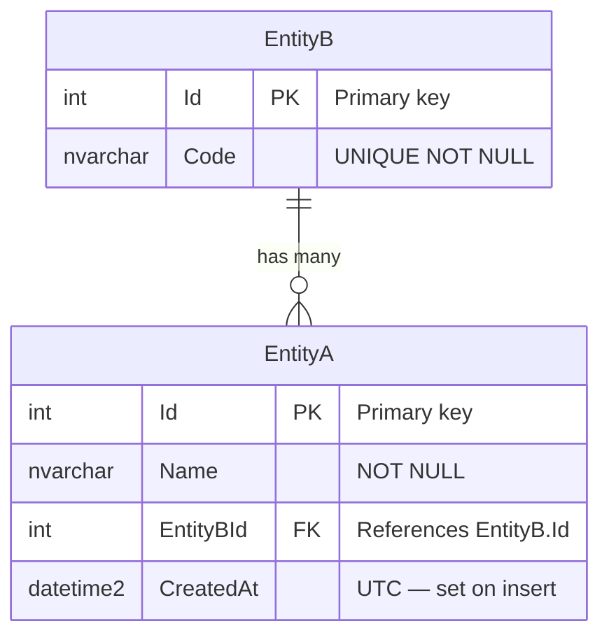

<!-- TEMPLATE -->
# Architecture — Data Model

> Load this file when adding or changing how the add-in reads or writes document data,
> application settings, or any external data store, or when reasoning about data ownership.
>
> VSTO add-ins rarely own a relational schema — they primarily work with the Office document
> model (workbook ranges, worksheet cells, document properties, custom XML parts) and
> optionally a backing store (SQL Server, SharePoint, REST API, local file).

## Document Data Model

> Describe the in-document data structures the add-in reads or writes.

| Host object | Location | Data stored | Read by | Written by |
|-------------|----------|-------------|---------|------------|
| `Worksheet` | | | | |
| `Range` / named range | | | | |
| Custom XML part | | | | |
| Document property | | | | |
| ListObject (table) | | | | |

> ⚠ Could not determine — populate from actual Office object model usage in codebase

## Application Settings & Persistence

> Where the add-in stores configuration or user preferences outside the document.

| Setting store | Kind | Location | Access pattern |
|---------------|------|----------|----------------|
| Registry | `HKCU\Software\…` | | |
| Isolated storage | | | |
| App.config / settings file | | | |
| SQL Server | | | |
| SharePoint list | | | |
| REST API | | | |

> ⚠ Could not determine — populate from actual settings/persistence code

## Backing Store (if any)

> Complete this section only if the add-in talks to an external database or store.
> If no database: delete this section and the ERD below.

### Entity Relationship Diagram

> ⚠ Replace the example entities above with the actual backing store schema, or delete this section if there is no database.

| Entity / Table | Store | Owner module | Key columns | Purpose |
|----------------|-------|--------------|-------------|---------|

## COM Object Lifecycle & Data Access

> Document how the add-in acquires, uses, and releases Office COM objects to avoid memory
> leaks and the "two-dot rule" (never chain COM calls without releasing intermediates).

| COM object | Acquired via | Released via | Notes |
|------------|-------------|--------------|-------|
| `Application` | `Globals.ThisAddIn.Application` | — (host-owned) | |
| `Workbook` | | | |
| `Worksheet` | | | |
| `Range` | | | |

> ⚠ Could not determine — populate from actual COM interop patterns in codebase

## Data Ownership

| Data / aggregate | Owner | Written by | Read by |
|-----------------|-------|-----------|---------|

## Data Lineage

> Where this application's data comes from, how it is transformed, where it is stored, and where
> it leaves the system. **No fixed shape** — the diagrams, tables, and sub-sections follow this
> application (one flow or several, by data kind or by journey). Load this section when changing a
> field, its calculation, where it is stored, who can export it, or how long it is kept.
>
> Must answer, from the code:
> - Where does each important data element enter (user input, upload, upstream system, job, bulk load)?
> - What changes it on the way (calculation, mapping, masking, aggregation), and in which code?
> - Where is it stored, and for how long (retention / purge)?
> - Where does it leave (exports, reports, downstream systems, browser storage, logs, telemetry),
>   and what must never leave?
> - Which elements are sensitive (confidential, PII, B-series — see `.claude/business-context.md`)?

> ⚠ Could not determine — needs manual input
